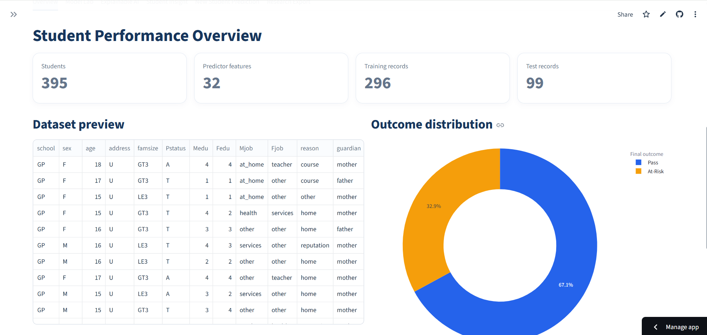
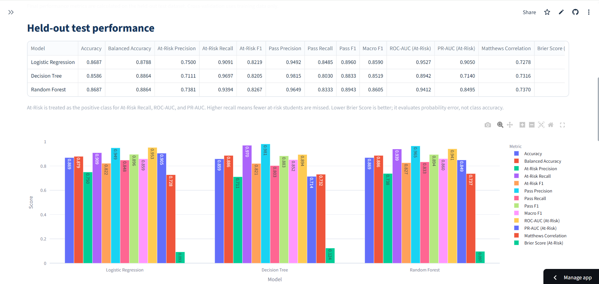
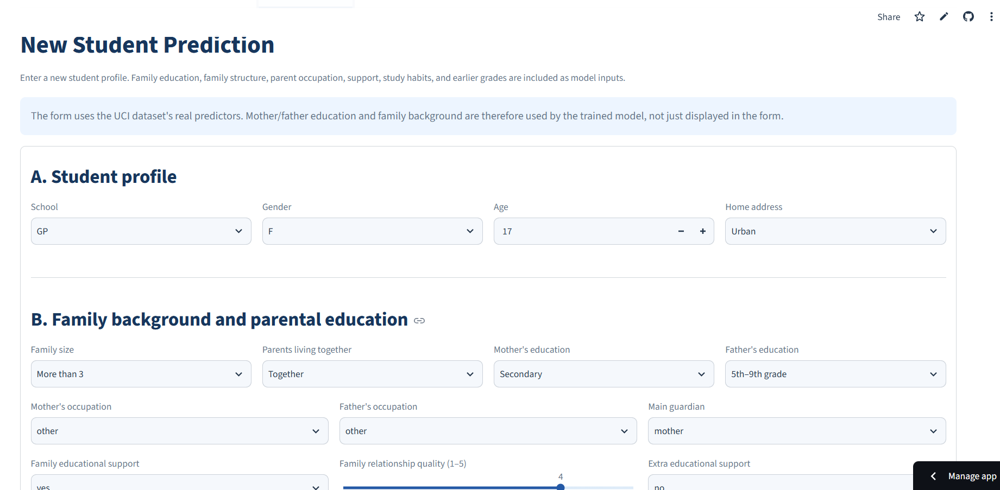
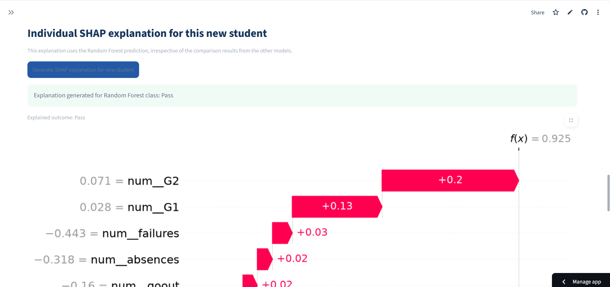
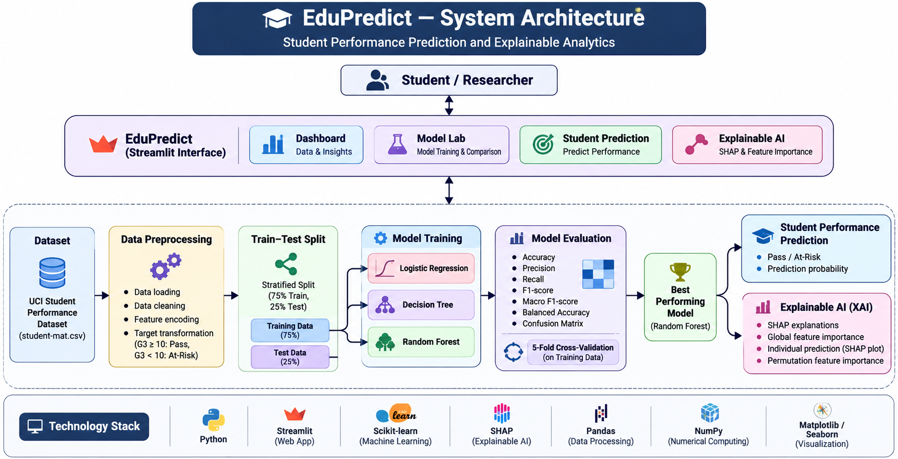

# EduPredict — Student Performance Prediction and Explainable Analytics

<p align="center">
  
  
  
  
  
</p>

<p align="center">
  <strong>An Explainable Machine Learning System for Early Identification of Students at Academic Risk.</strong>
</p>

<p align="center">
  <a href="https://edupredict-sudhanshsu.streamlit.app/">
    
  </a>
</p>

---

## 1. Project Overview

**EduPredict** is a machine learning-based student performance prediction and explainable analytics application designed to identify students who may be at academic risk.

The system uses student demographic, family, social, and academic-related information to predict whether a student is likely to pass or fall into the at-risk category.

Unlike a conventional prediction system, EduPredict also incorporates Explainable Artificial Intelligence (XAI) techniques to help users understand which features influence model predictions.

The application compares multiple machine learning algorithms, evaluates their performance, and provides both global and individual prediction explanations.

### Key Objectives

- Identify students who may be at academic risk.
- Compare different machine learning classification algorithms.
- Evaluate models using multiple classification metrics.
- Apply cross-validation to assess model stability.
- Explain model predictions using SHAP.
- Identify influential student-related factors.
- Provide an interactive interface for student performance prediction.

## 2. Live Application

**Try EduPredict:**  
https://edupredict-sudhanshsu.streamlit.app/

**GitHub Repository:**  
https://github.com/sudhanshukumarjha108/EduPredict

## 3. Application Screenshots

### Dashboard

The dashboard provides an overview of the dataset, student performance distribution, and key analytical insights.



### Model Lab

The Model Lab compares machine learning models and presents evaluation metrics and visualizations.



### Student Prediction

Users can enter student-related information to obtain a predicted performance category.



### Explainable AI

The Explainable AI section provides SHAP-based explanations to understand the influence of features on model predictions.



## 4. System Architecture

EduPredict follows a machine learning workflow consisting of dataset loading, preprocessing, model training, evaluation, prediction, and explainability.



An editable Mermaid version of the architecture is available in [architecture.md](architecture.md).

### System Workflow

1. **Dataset Loading:** Load the UCI Student Performance Mathematics dataset.
2. **Data Preprocessing:** Prepare the input features and target variable.
3. **Train-Test Split:** Divide the dataset using stratified sampling.
4. **Model Training:** Train Logistic Regression, Decision Tree, and Random Forest.
5. **Model Evaluation:** Evaluate models using classification metrics.
6. **Cross-Validation:** Perform stratified 5-fold cross-validation on the training partition.
7. **Prediction:** Generate predictions for new student records.
8. **Explainability:** Use SHAP and permutation feature importance to interpret model behaviour.

## 5. Dataset Information

EduPredict uses the **Student Performance Dataset — Mathematics (`student-mat.csv`)** from the UCI Machine Learning Repository.

**Dataset source:**  
https://archive.ics.uci.edu/dataset/320/student+performance

### Dataset Features

The dataset contains student-related information covering several categories:

| Category | Examples |
|---|---|
| Demographic | Age, sex, address |
| Family | Family size, parental status |
| Parental education | Mother's and father's education |
| Family background | Parents' jobs, guardian |
| Academic behaviour | Study time, previous failures, absences |
| School support | Extra educational support, paid classes |
| Social behaviour | Going out, alcohol consumption, free time |
| Health | Health status and lifestyle-related features |
| Academic grades | G1, G2, G3 |

### Target Variable

The final mathematics grade, `G3`, is transformed into a binary classification target:

- **Pass:** G3 >= 10
- **At-Risk:** G3 < 10

### Early-Stage Prediction Strategy

For the early-stage experiment, G1 and G2 are excluded from the model inputs because they represent intermediate academic grades that may not be available at the beginning of a semester.

This helps evaluate whether student-related information can support early identification of academic risk.

## 6. Machine Learning Models

EduPredict compares three classification algorithms.

| Model | Description |
|---|---|
| Logistic Regression | Linear classification baseline |
| Decision Tree | Tree-based classification model |
| Random Forest | Ensemble learning algorithm using multiple decision trees |

### Model Evaluation Metrics

The models are evaluated using:

- Accuracy
- Precision
- Recall
- F1-score
- Macro F1-score
- Balanced Accuracy
- Confusion Matrix

Particular attention is given to the **At-Risk Recall** metric because identifying students who may fail is an important objective of the system.

## 7. Experimental Results

EduPredict evaluates two experimental configurations to investigate student performance prediction under different feature availability conditions.

### Experiment 1: Full-Feature Prediction

This experiment includes intermediate academic grades (`G1` and `G2`) along with other student-related features.

**Objective:** Predict the final student performance category using the available demographic, social, family, and academic information, including intermediate grades.

#### Held-Out Test Set Results

| Model | Accuracy | At-Risk Recall | Macro F1 |
|---|---:|---:|---:|
| Logistic Regression | 86.87% | 90.91% | 85.90% |
| Decision Tree | 85.86% | 96.97% | 85.19% |
| Random Forest | 86.87% | 93.94% | 86.05% |

**Observations:**
- Logistic Regression and Random Forest achieved equal accuracy.
- Decision Tree achieved the highest At-Risk Recall.
- Random Forest achieved the highest Macro F1-score.

### Experiment 2: Early-Stage Prediction

This experiment excludes `G1` and `G2` from the input features.

**Objective:** Investigate whether academic risk can be identified without relying on intermediate academic grades.

#### Held-Out Test Set Results

| Model | Accuracy | Balanced Accuracy | At-Risk Precision | At-Risk Recall | At-Risk F1 | Macro F1 |
|---|---:|---:|---:|---:|---:|---:|
| Logistic Regression | 59.60% | 55.30% | 40.00% | 42.42% | 41.18% | 55.20% |
| Decision Tree | 61.62% | 59.85% | 43.90% | 54.55% | 48.65% | 59.00% |
| Random Forest | 70.71% | 65.15% | 57.14% | 48.48% | 52.46% | 65.65% |

### Stratified 5-Fold Cross-Validation — Early-Stage Experiment

| Model | Mean Accuracy | Accuracy SD | Mean Macro F1 | Macro F1 SD |
|---|---:|---:|---:|---:|
| Logistic Regression | 67.58% | 5.06% | 63.84% | 6.43% |
| Decision Tree | 62.15% | 4.81% | 59.31% | 5.28% |
| Random Forest | 69.94% | 2.10% | 63.78% | 3.34% |

### Comparative Interpretation

The full-feature experiment achieved substantially higher test accuracy than the early-stage experiment. This indicates that intermediate academic grades provide valuable predictive information.

However, the two experiments serve different purposes:

- **Full-feature prediction:** Uses G1 and G2 to improve prediction of final academic performance.
- **Early-stage prediction:** Excludes G1 and G2 to investigate academic risk identification using information available before intermediate grades.

The full-feature results should not be interpreted as evidence of beginning-of-semester prediction.

The early-stage experiment is more relevant to identifying students who may require academic support before intermediate grades become available.

**Research consideration:** Predictive performance does not establish causation. External validation on additional educational datasets is required before generalizing the findings.

## 8. Explainable Artificial Intelligence (XAI)

EduPredict incorporates explainability techniques to make machine learning predictions more understandable.

### SHAP — SHapley Additive exPlanations

SHAP is used to interpret the contribution of input features to model predictions.

The application provides:

- Global feature importance.
- Individual prediction explanations.
- Feature contribution visualizations.
- Positive and negative feature contributions.

### Permutation Feature Importance

Permutation importance estimates the influence of a feature by measuring the change in model performance when that feature's values are shuffled.

Together, these methods help users understand which student-related features influence model behaviour.

**Important:** Feature importance indicates model associations, not proof of causation.

## 9. Technology Stack

| Component | Technology |
|---|---|
| Programming Language | Python |
| Web Application | Streamlit |
| Data Processing | Pandas, NumPy |
| Machine Learning | Scikit-learn |
| Explainable AI | SHAP |
| Data Visualization | Matplotlib, Seaborn |
| Dataset | UCI Student Performance Dataset |
| Version Control | Git and GitHub |
| Deployment | Streamlit Community Cloud |

## 10. Project Structure

```text
EduPredict/
│
├── .streamlit/
│   └── config.toml
│
├── data/
│   └── student-mat.csv
│
├── screenshots/
│   ├── dashboard.png
│   ├── model-lab.png
│   ├── prediction.png
│   └── explainable-ai.png
│
├── architecture.md
├── app.py
├── requirements.txt
├── README.md
└── .gitignore
```

## 11. Installation and Setup

Follow these steps to run EduPredict locally.

### Prerequisites

- Python 3.12 recommended
- Git
- pip

### Step 1: Clone the Repository

```bash
git clone https://github.com/sudhanshukumarjha108/EduPredict.git
```

### Step 2: Navigate to the Project

```bash
cd EduPredict
```

### Step 3: Create a Virtual Environment

```bash
python -m venv .venv
```

### Step 4: Activate the Environment

**Windows PowerShell:**

```powershell
.\.venv\Scripts\Activate.ps1
```

### Step 5: Install Dependencies

```bash
python -m pip install --upgrade pip
pip install -r requirements.txt
```

### Step 6: Run the Application

```bash
python -m streamlit run app.py
```

The application will be available at:

```text
http://localhost:8501
```

## 12. Research Methodology

The research follows a comparative experimental approach.

1. Dataset selection and exploration.
2. Data preprocessing and target transformation.
3. Feature selection for early-stage prediction.
4. Stratified train-test partitioning.
5. Training of three classification algorithms.
6. Held-out test set evaluation.
7. Stratified 5-fold cross-validation on training data.
8. Model comparison using classification metrics.
9. SHAP-based global and individual explanations.
10. Interpretation of influential features and model limitations.

The held-out test set is used for final model evaluation. Cross-validation is performed on the training partition.

## 13. Limitations and Future Scope

### Current Limitations

- The dataset represents student records from Portuguese secondary schools.
- The dataset size limits the generalizability of findings.
- Student performance is influenced by multiple factors that may not be captured in the dataset.
- At-Risk recall requires further improvement.
- Predictions should not be treated as definitive assessments of individual students.

### Future Enhancements

- Evaluate the framework on larger and more diverse educational datasets.
- Improve early identification of at-risk students.
- Explore additional machine learning and ensemble algorithms.
- Investigate calibration and threshold optimization.
- Add personalized academic intervention recommendations.
- Conduct external validation across different educational institutions.

## 14. Research and Academic Context

**Project:** EduPredict  
**Research Area:** Explainable Artificial Intelligence and Educational Data Mining  
**Primary Objective:** Early identification of students at academic risk using machine learning.

**Institution:**  
Galgotias University  
School of Computer Applications and Technology

**Project Team:**
- Sudhanshu Kumar Jha
- Riya Kumari
- Shivani Rana

## 15. Acknowledgements

- UCI Machine Learning Repository for providing the Student Performance Dataset.
- The developers and maintainers of Python, Streamlit, Scikit-learn, SHAP, Pandas, and NumPy.
- Galgotias University, School of Computer Applications and Technology.

## 16. License

This repository is intended for academic and educational purposes. Please refer to the dataset's original UCI source for its terms of use and attribution requirements.

---

<p align="center">
  <strong>EduPredict — Making Student Performance Prediction More Explainable.</strong>
</p>

<p align="center">
  Built with Python, Machine Learning, and Explainable AI.
</p>